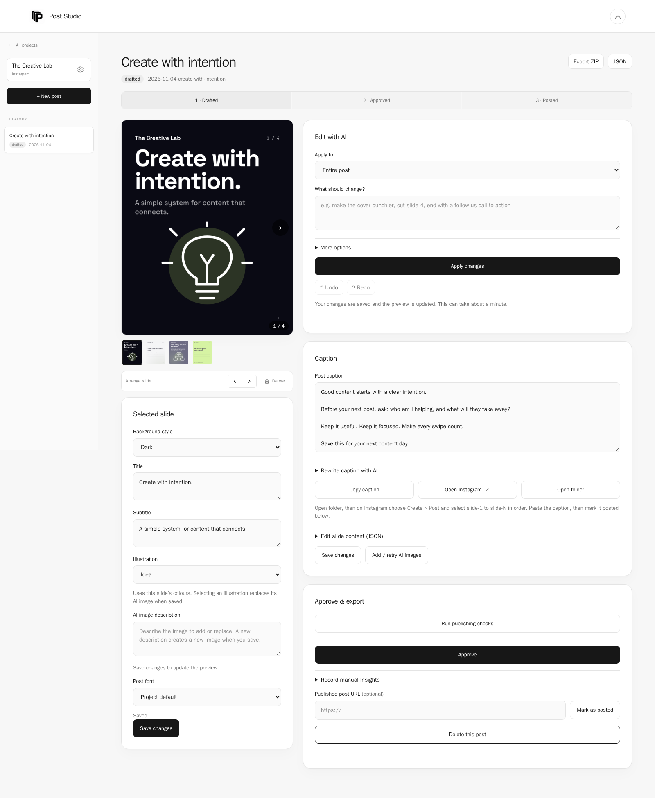

<div align="center">

# Post Studio

### Free, open-source Instagram carousel generator powered by Claude Code, with no API key.

Turn any topic into a ready-to-post **Instagram carousel** (slides and caption) in minutes. Runs locally on your machine and uses your own Claude Code login.

[](LICENSE)
[](https://nodejs.org)
[](https://claude.com/claude-code)
[](#requirements)
[](#safety-and-privacy)

[Quick start](#quick-start) · [Features](#features) · [How it works](#how-it-works) · [FAQ](#faq) · [Contributing](#contributing)

</div>



*Review a sample carousel, refine the slides and caption, then approve and export.*

---

## What is Post Studio?

**Post Studio** is a local, multi-project **AI social media content studio**. It researches trending topics for your audience, writes the slides and caption with **Claude**, renders pixel-perfect PNGs with Playwright, and lets you review, edit and export. Use it as an **Instagram carousel maker**, a **social media post generator**, or a **content automation workflow** for a brand, agency or personal account.

There is no SaaS subscription, no API key and no cloud upload. It calls the `claude` CLI already installed on your computer, so generation runs on your existing **Claude Code** plan.

> Today: **Instagram carousels and Reel production plans**. Formats (what a post is) are separate from channels (where it goes), so rendered video, LinkedIn, X/Twitter and more can be added.

## Features

- **AI topic suggestions**: searches recent news for your audience and skips anything already in the project's history.
- **AI carousels and Reel plans**: Claude writes carousels or a Reel's hooks, teleprompter script, timed storyboard, shot list and filming checklist.
- **Instagram toolkit**: build a seven-day plan, audit a profile, and draft approval-gated comment or DM replies.
- **Publishing checks and manual Insights**: validate captions, hashtags, CTAs and Reel plans before approval; record reach, saves, shares and follows manually after publishing.
- **Branded, on-brand design**: pulls colours and a logo from your website, or from an image, and derives four colour themes.
- **Edit with a prompt**: type "shorten slide 2, add a CTA" and Claude revises the slides and caption. Undo and redo saved changes during the current editing session.
- **Multi-project workspace**: each project (brand, client or account) has its own settings, history, previews and exports.
- **Visual controls**: choose project and post fonts, add built-in illustrations, or request optional AI images through Codex. Adjust image placement without regenerating the picture.
- **Slide types**: `cover`, `text`, `list`, `stat`, `table`.
- **Review workflow**: edit, reorder or delete slides, re-render, approve, then post manually.
- **Export anywhere**: one post or a whole project as ZIP (images, captions, settings) or JSON.
- **Local accounts**: sign up, change name, email or password. Passwords are scrypt-hashed.
- **Claude Code plugin**: slash commands for setup, topics, drafting and posting.

## Quick start

```bash
git clone https://github.com/guna81/post-studio.git && cd post-studio
npm install && npx playwright install chromium
node bin/post-studio.mjs doctor     # checks Node 20+, Claude Code, Playwright, Chromium
node bin/post-studio.mjs start      # open http://localhost:4173, sign up, create a project
```

Then: **create a project → Suggest topics → Generate → review and edit → export and post.**

## How it works

1. **Create a project** with your platform, theme, goal, audience, tone, logo and hashtags.
2. **Plan or research**: build a weekly calendar, audit a profile, or have Claude search recent news relevant to your audience.
3. **Generate**: Claude writes a carousel and caption, or a shoot-ready Reel plan. Carousels render to PNG; Reels export a storyboard and preview.
4. **Refine**: edit text by hand or by prompt, reorder slides, re-render.
5. **Run publishing checks**, export the assets and caption, then publish to Instagram. Add manual Insights later to learn what worked.

For step-by-step editing, image setup, Reel exports, and troubleshooting, see the [workflow guide](docs/workflows.md).

## Requirements

- **[Claude Code](https://claude.com/claude-code) is required.** Post Studio has no AI of its own and needs no API key. Topic suggestions and slide/caption generation call the `claude` CLI (`claude -p`) on your machine, using your own login and plan usage. Install it and run `claude` once to log in. Without it you can still create projects, edit settings, and view or export existing posts, but Suggest topics and Generate will fail.
- **Optional AI images** use the `codex` CLI. Install it separately, sign in with `codex login`, and ensure image generation is available in your setup. Without it, carousels still render with text and built-in illustrations.
- Node 20+, plus Playwright with Chromium (installed by the commands above) for rendering PNGs.

## Where data lives

Accounts and projects are stored in `~/.post-studio` (override with `POST_STUDIO_HOME`; `post-studio where` prints it). Each project is a plain folder:

```
~/.post-studio/projects/<id>/
  project.json    id, owner
  brand.json      name, about, goal, audience, tone, cta, hashtags, logo, colours, defaults
  theme.json      slide size, 4 colour themes (derived from your two colours), fonts
  posts-log.json  date, title, status per post
  drafts/         one folder per post (carousel or Reel plan; see below)
  assets/         logo
```

Carousel drafts contain `slides.json`, `caption.txt`, `slide-N.png`, and `review.html`; generated pictures live in the draft’s `assets/` folder. Reel drafts contain `reel.json`, `caption.txt`, `reel-plan.md`, and `preview.svg`.

Existing workspace folder? `post-studio import <dir> <your-email>` copies it in as a project.
Env: `PORT`, `POST_STUDIO_HOME`, `POST_STUDIO_SIGNUP=off` (close signup once the first account exists).

## Formats and channels

```
formats/carousel/   index.mjs (prompt, validation, previews), render.mjs, FORMAT.md
formats/reel/       index.mjs (plan schema), render.mjs, FORMAT.md
channels/instagram/ index.mjs (caption rules, URL check, hints), CHANNEL.md
```

To add one, copy a folder, register it in `formats/registry.mjs` or `channels/registry.mjs`, and describe it in its `.md` file (the skills read those). Each log entry records its `format` and `channel`. See `formats/carousel/FORMAT.md` for the slide schema.

## Claude Code plugin (skills)

Point Claude Code at this folder as a plugin to get `/post-studio-setup`, `/post-studio-topics`, `/post-studio-draft` and `/post-studio-post`:

```bash
claude --plugin-dir post-studio
```

They use `cli.mjs` for the log and each format's renderer for output.

## Safety and privacy

Accounts, projects and exports are stored locally. AI requests send the relevant prompts and context through Claude Code; optional image generation uses Codex. Website theme extraction fetches the URL you provide, and carousel rendering may fetch Google Fonts. The server binds to 127.0.0.1 only, checks the Host header, accepts JSON only, uses HttpOnly SameSite=Strict session cookies, rate-limits login, isolates each user's projects, and gives Claude web search as its only tool; the server writes all files.

## FAQ

**Is Post Studio free?**
Yes. It is MIT-licensed and free. You only need a Claude Code login and plan.

**Do I need an OpenAI or Anthropic API key?**
No. It uses the `claude` CLI you are already logged into.

**Does it post to Instagram automatically?**
No. It generates drafts, checks and exports for you to review and post manually. Reply drafts are never sent automatically, and Insights are entered manually.

**Can I use it for client work or multiple brands?**
Yes. Each project has its own brand settings, history and exports.

**Can it make formats other than carousels?**
It supports carousels and Reel production plans today. The format and channel architecture is built so rendered video and other platforms can be added.

## Contributing

Issues and pull requests are welcome. Ideas: new formats (video, single image, stories), new channels (LinkedIn, X, Threads), more slide types and themes. If Post Studio helps you, please **star the repo** so others can find it.

## License

[MIT](LICENSE)

<sub>Keywords: Instagram carousel generator, AI carousel maker, social media content automation, Claude Code, Claude Code plugin, self-hosted social media tool, open source content studio, Playwright, brand-themed posts, no API key.</sub>
