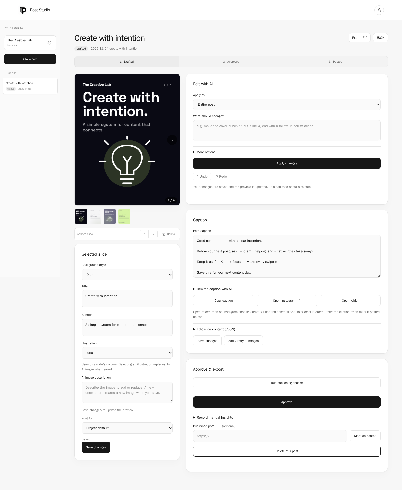

# Working in Post Studio

[Back to the README](../README.md)

## Create a carousel

1. Create a project with your audience, goal, tone, colours, logo, hashtags, and default font.
2. Choose Carousel and a size: 1080×1350, 1080×1440, or 1080×1080.
3. Enter a topic or request topic suggestions. Refine the brief before generating; optional controls include slide count, CTAs, emotion, font, and visual elements.
4. Generate, then review each slide and the caption. Use the thumbnails to select a slide, edit its fields, or rearrange it. Save changes to render the updated slides.
5. Run publishing checks, resolve errors, then approve and export the ZIP. Upload the PNGs to Instagram in numerical order and paste the caption.
6. Mark the post as posted and record reach, saves, shares, and follows manually when available.

## Refine a draft

**Edit with AI** can revise the entire carousel or the selected slide. Describe the desired change, such as “shorten slide 2” or “add a save CTA to the last slide.” The caption has its own rewrite control. Review the result before saving or approving.

Undo and redo track up to 50 saved states while editing the open post. This session history resets when you reload or open another draft. A separate server backup supports undoing the last AI revision where available.

Choose a project font in settings, or override it for a post. Available fonts are Space Grotesk, Inter, Poppins, Montserrat, DM Sans, and Lora. Rendering loads font resources from Google Fonts; unavailable resources can cause fallback fonts.

## Illustrations and optional AI images

Cover and text slides support built-in illustrations: AI chip, growth, target, idea, workflow, and conversation. These use the slide’s colours and require no image service.

AI images require a separately installed, signed-in Codex CLI with image generation available. The app’s `doctor` command checks whether the CLI is on PATH; it does not verify image generation access.

Select **AI images** when generating, or describe an image in the selected slide’s image field. Save changes or use **Add / retry AI images** to request missing pictures. Selecting an illustration replaces that slide’s image when saved.

Image layouts include Auto, Background, Split left, Split right, Image top, and Image bottom. Change the layout and save to reuse the existing picture. Changing the image description requests a new picture; unchanged descriptions reuse existing files.

If image generation fails, the slide renders without the picture. Check the Codex login and image generation availability, then retry. Each image request can take several minutes.

## Create a Reel production plan

Choose **Reel (script and storyboard)** before generating. A plan includes three hook options, a selected hook, a 15–45 second script, four to eight timed storyboard beats, a shot list, and a filming checklist.

Review and edit the plan in the JSON editor, then save. AI carousel revisions are available for carousels; revise Reel content through its plan editor. Export includes `reel.json`, `reel-plan.md`, `preview.svg`, and `caption.txt`. Use these to film and edit the video yourself.

## Plan and review Instagram content

The Instagram toolkit can suggest a seven-day plan, audit profile details you paste, and draft comment or DM replies from messages you provide. Profile audits use those supplied details. Reply drafts require your review and manual sending. Weekly plans may include Story ideas; the app’s draft formats are Carousel and Reel plan.

Publishing checks inspect content, caption length, the app’s five-hashtag limit, CTA wording, and image alt text. Resolve errors before approval and review warnings. These checks do not measure actual reach or predict performance. Insights are entered manually after a post is marked as posted.

## Troubleshooting

- **Topics or text generation fail:** run `claude` in a terminal to check your login, then run `node bin/post-studio.mjs doctor`.
- **Carousel rendering fails:** run `npm install` and `npx playwright install chromium` in the app folder.
- **AI images are missing:** check that `codex` is on PATH and signed in, then retry image generation.
- **Looking for exports or project data:** run `node bin/post-studio.mjs where`. The default is `~/.post-studio`; `POST_STUDIO_HOME` overrides it.
